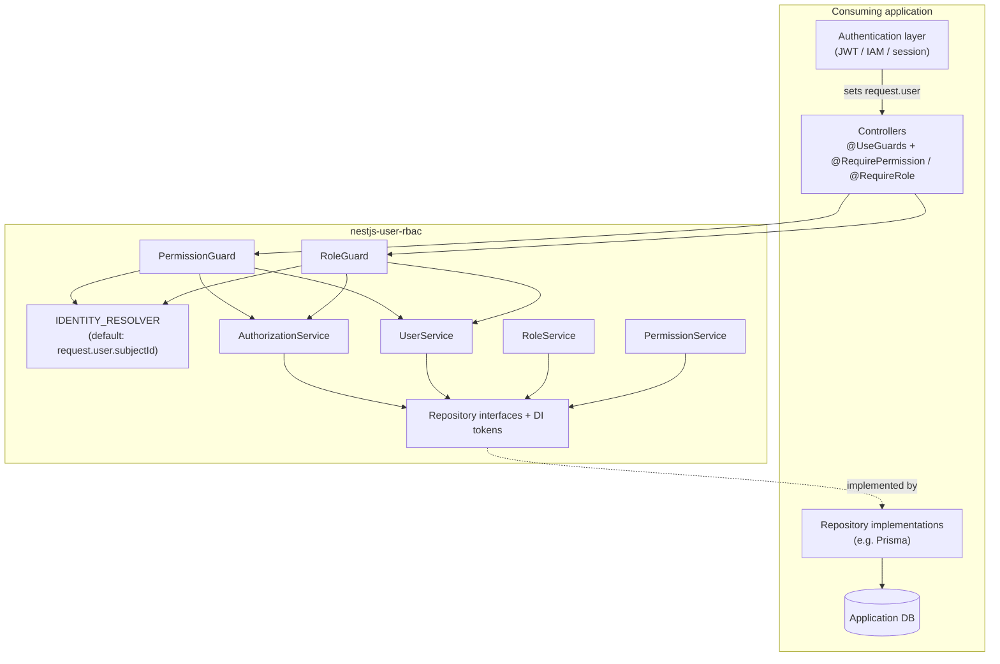
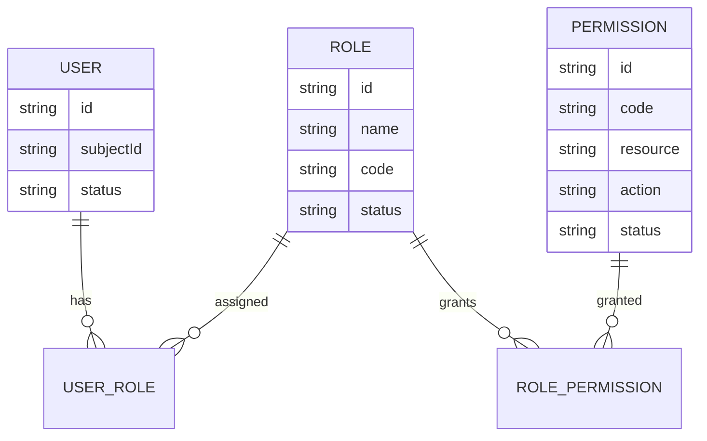
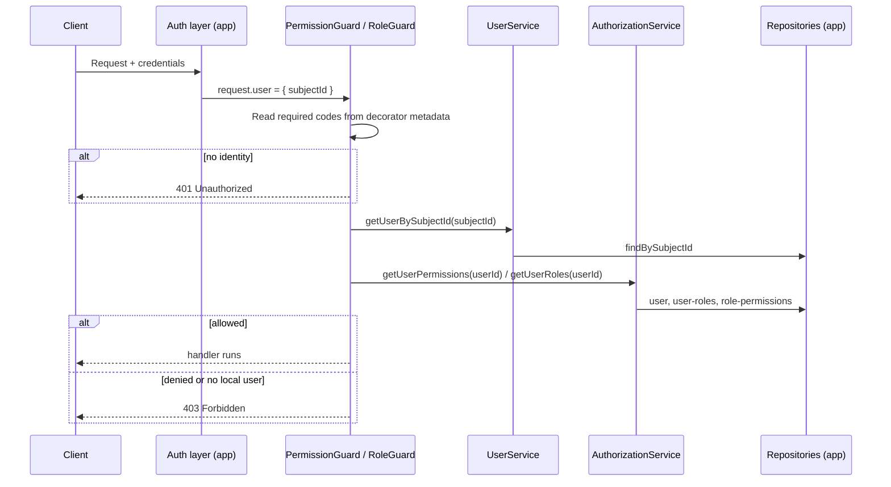

# Architecture and Integration Guide

Audience: engineers integrating `@shree-maruti/nestjs-user-rbac` into a NestJS application.

## 1. What this package is

A database-agnostic RBAC library. It answers one question: **does this already-authenticated user hold this permission or role in this application?** It does not authenticate anyone, issue tokens, or talk to IAM. It has no database code; each application supplies its own repositories.

| Concern                                                             | Owner                                        |
| ------------------------------------------------------------------- | -------------------------------------------- |
| Who is the caller (login, JWT, session, IAM check)                  | The application / IAM                        |
| Users, roles, permissions, assignments, and the allow/deny decision | This package                                 |
| Where the data is stored (Prisma, SQL, etc.)                        | The application (repository implementations) |

## 2. Components



The package depends only on repository **interfaces**, injected through `Symbol` tokens. The five tokens are `USER_REPOSITORY`, `ROLE_REPOSITORY`, `PERMISSION_REPOSITORY`, `USER_ROLE_REPOSITORY` and `ROLE_PERMISSION_REPOSITORY`. `UserRbacModule.forRoot(...)` registers each provider once, globally.

## 3. Data model



- `User.subjectId` links the local user to whatever identity the application's own authentication produces — a central identity provider's id, or just that application's own local user id.
- Permission `code` is a plain string such as `ticket.create`. Each application defines its own vocabulary.
- Role `code` (for example `support_manager`) is what `@RequireRole` matches.
- Only **active** users, roles and permissions count toward a decision.

## 4. Request flow



### Guard behaviour

| Situation                                                    | Result                                       |
| ------------------------------------------------------------ | -------------------------------------------- |
| Route has no `@RequirePermission` / `@RequireRole`           | Request passes                               |
| No authenticated identity (`request.user.subjectId` missing) | 401                                          |
| `subjectId` has no local user                                | 403                                          |
| Permission or role missing, or user/role/permission inactive | 403                                          |
| Several codes in one decorator                               | **All** are required                         |
| Method-level and class-level decorator both present          | Method-level wins (replaces, does not merge) |
| Repository or other unexpected error                         | Propagates unchanged (not turned into 403)   |

To require both a permission and a role on one route, stack both guards and both decorators.

## 5. Integration steps

**1. Install and peer dependencies.** The app provides `@nestjs/common`, `@nestjs/core`, `reflect-metadata` and `rxjs`.

**2. Implement the five repositories** against your own database. The contracts are in `src/*/repositories/`:

| Interface                   | Methods                                                                                     |
| --------------------------- | ------------------------------------------------------------------------------------------- |
| `IUserRepository`           | `findById`, `create`, `update`, `delete`, `findBySubjectId`, `search`                       |
| `IRoleRepository`           | `findById`, `create`, `update`, `delete`, `findByCode`, `search`                            |
| `IPermissionRepository`     | `findById`, `create`, `update`, `delete`, `findByCode`, `search`                            |
| `IUserRoleRepository`       | `assign`, `remove`, `findRolesByUserId`, `findAssignment`                                   |
| `IRolePermissionRepository` | `assign`, `remove`, `findPermissionsByRoleId`, `findPermissionsByRoleIds`, `findAssignment` |

Each app needs tables for users, roles, permissions, user-role and role-permission. The shapes are `IUser`, `IRole`, `IPermission`, `IUserRole` and `IRolePermission`.

**3. Register the module.**

```ts
@Module({
  imports: [
    UserRbacModule.forRoot({
      userRepositoryProvider: {
        provide: USER_REPOSITORY,
        useClass: PrismaUserRepository,
      },
      roleRepositoryProvider: {
        provide: ROLE_REPOSITORY,
        useClass: PrismaRoleRepository,
      },
      permissionRepositoryProvider: {
        provide: PERMISSION_REPOSITORY,
        useClass: PrismaPermissionRepository,
      },
      userRoleRepositoryProvider: {
        provide: USER_ROLE_REPOSITORY,
        useClass: PrismaUserRoleRepository,
      },
      rolePermissionRepositoryProvider: {
        provide: ROLE_PERMISSION_REPOSITORY,
        useClass: PrismaRolePermissionRepository,
      },
    }),
  ],
})
export class AppModule {}
```

**4. Authenticate upstream, and attach the identity.** Your auth guard or middleware (not this package) must run first and set `request.user = { subjectId: '<your app's own identity for this caller>' }`. If your app's authenticated request carries the identity under a different shape, provide your own `IIdentityResolver` via `identityResolverProvider` on `forRoot(...)` — not as a local provider in your own module, which would never actually reach `PermissionGuard`/`RoleGuard` (they live inside this package's own `AuthorizationModule`, and a provider a module declares locally always wins over one from elsewhere for resolving that module's own providers).

```ts
UserRbacModule.forRoot({
  // ...the five repository providers...
  identityResolverProvider: {
    provide: IDENTITY_RESOLVER,
    useClass: MyIdentityResolver,
  },
});
```

**5. Provision local users.** A caller needs a local `User` row whose `subjectId` matches the identity your app's own authentication produced, or every guarded route returns 403. Create it with `UserService.createUser({ subjectId })`, for example on first login or through an admin flow.

**6. Seed permissions, roles and assignments** with `PermissionService`, `RoleService`, and their assign methods:

```ts
const perm = await permissionService.createPermission({
  code: 'ticket.create',
  resource: 'ticket',
  action: PermissionAction.CREATE,
  description: 'Create tickets',
});
const role = await roleService.createRole({
  name: 'Support Manager',
  code: 'support_manager',
  description: 'Manages tickets',
});
await permissionService.assignPermissionToRole(role.id, perm.id);
await roleService.assignRoleToUser(user.id, role.id);
```

**7. Protect routes.**

```ts
@Controller('tickets')
@UseGuards(AuthGuard /* yours, runs first */, PermissionGuard, RoleGuard)
export class TicketController {
  @Post()
  @RequirePermission('ticket.create')
  create() {}

  @Delete(':id')
  @RequirePermission('ticket.delete', 'ticket.audit') // needs both
  @RequireRole('support_manager')
  remove() {}
}
```

**8. Programmatic checks** (outside HTTP): inject `AuthorizationService` and call `hasPermission` (`false` for an unknown or inactive user), `authorize` (throws `AuthorizationDeniedException`, a 403), `getUserPermissions` or `getUserRoles`.

## 6. Not included (on purpose)

- Authentication, JWT, Passport and IAM calls (application-access checks are a later phase).
- HTTP controllers and DTOs for managing users, roles and permissions. There are no endpoints in this package, so there is nothing to call over HTTP until an application exposes them.
- Any Prisma schema or database access.
- A `PermissionResource` enum. Resource names are per-application strings.

## 7. Verifying an integration

1. Provision a user, a role and a permission, then assign them as in step 6.
2. Call a guarded route with `request.user.subjectId` set: expect 200.
3. Remove the assignment or deactivate the role: expect 403.
4. Call without an identity: expect 401.
